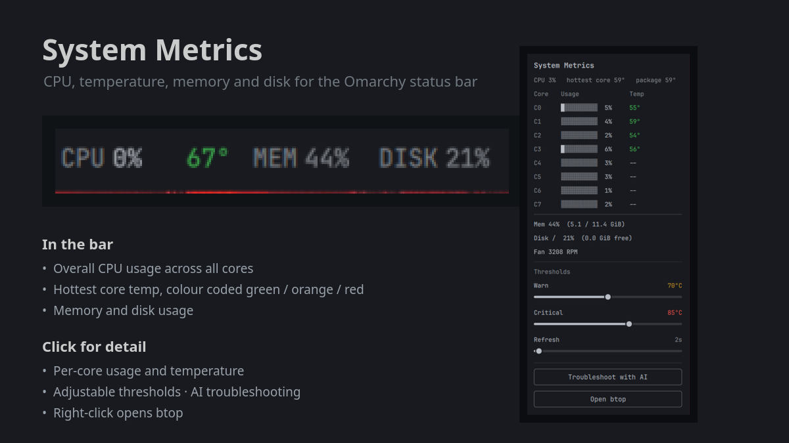

# System Metrics

A status bar widget for [Omarchy](https://omarchy.org/) that shows live CPU,
temperature, memory and disk usage at a glance, with temperature colour coded
green, orange or red.

Built with Quickshell (QML) and a small shell sampler that reads `/proc` and
`sensors`.



## Features

- **CPU usage** — overall utilisation across all cores and threads.
- **Temperature** — the hottest core, colour coded:
  - green below the warning threshold (default 70 °C)
  - orange at or above the warning threshold
  - red at or above the critical threshold (default 85 °C)
  - bold when in the orange or red band, so a hot machine is obvious.
- **Memory** — percentage of RAM used.
- **Disk** — percentage of the chosen mount point used.
- **Per-core detail on click** — a popup with every thread's usage (a 10-segment
  bar plus a percentage), every core's temperature, package temperature, memory
  used/total in GiB, disk usage with free space, and fan RPM when available.
- **AI troubleshooting** — one button in the popup hands the current readings to
  your default coding agent (`omarchy agent prompt ...`) and asks it to find the
  cause of the heat and what to do about it.
- **Live thresholds** — warning and critical temperatures, refresh interval and
  the disk mount point are all adjustable from the popup.
- **Right-click** opens [btop](https://github.com/aristocratos/btop) for a full
  process view.

## Bar appearance

The bar row reads like this, with fixed-width fields so nothing shifts when a
value crosses 10:

```
CPU 24%  99°  MEM 47%  DISK 21%
           └ colour coded by temperature
```

Right-clicking the widget opens btop. Left-clicking opens the detail popup.

## Install

Clone into your user plugin directory:

```bash
git clone https://github.com/alexllama/system-metrics \
  ~/.config/omarchy/plugins/io.github.alexllama.system-metrics
```

Make the sampler executable (the checkout normally preserves this):

```bash
chmod +x ~/.config/omarchy/plugins/io.github.alexllama.system-metrics/bin/metrics-sample
```

Add the widget to your bar:

```bash
omarchy bar put io.github.alexllama.system-metrics --section right
```

Then restart the shell so the bar picks up the widget:

```bash
omarchy restart shell
```

> **Note:** bar widgets are not hot-reloaded on this shell version — editing the
> plugin requires `omarchy restart shell` for the change to appear.

## Configuration

Settings can be edited from the popup (sliders for the temperature thresholds
and refresh interval) or set directly in `~/.config/omarchy/shell.json`:

```json
{
  "id": "io.github.alexllama.system-metrics",
  "warnTemp": 70,
  "critTemp": 85,
  "interval": 2,
  "diskPath": "/"
}
```

| Key        | Default | Description                                            |
|------------|---------|--------------------------------------------------------|
| `warnTemp` | `70`    | Temperature (°C) at or above which the reading is orange. |
| `critTemp` | `85`    | Temperature (°C) at or above which the reading is red.    |
| `interval` | `2`     | Seconds between samples.                               |
| `diskPath` | `"/"`   | Mount point whose disk usage is shown.                 |

If `critTemp` is set below `warnTemp`, the orange band simply collapses and
readings go straight to red — set the critical value higher than the warning.

## How it works

`bin/metrics-sample` prints one line of JSON per invocation:

| Field              | Source                                                        |
|--------------------|---------------------------------------------------------------|
| `cpu.overall`      | Mean of per-thread usage, from `/proc/stat` deltas.           |
| `cpu.perCore`      | Per-thread usage; the first call seeds the baseline (all 0).  |
| `temp.cores`       | Per-core temps from `sensors -j` (`coretemp`), newest first.  |
| `temp.max`         | Hottest core (or package) reading.                            |
| `temp.package`     | `Package id 0` from `coretemp`, when present.                 |
| `mem.usedPct`      | `(MemTotal - MemAvailable) / MemTotal` from `/proc/meminfo`.  |
| `disk.usedPct`     | Used percentage of the requested mount point (`df -P`).       |
| `disk.availKb`     | Free space in KiB.                                            |
| `fan`              | Fan RPM from `dell_smm` when present.                         |

CPU percentages are deltas between calls, so the sampler keeps a small state
file under `$XDG_RUNTIME_DIR` (`system-metrics-cpu.state`) holding the previous
`/proc/stat` counters. The first run after a reboot reports 0 % until a second
sample lands.

Temperature falls back gracefully when `coretemp` is unavailable: it will use
any `temp*_input` from `sensors`, then `/sys/class/thermal` zones.

## Requirements

- Omarchy with the Quickshell-based shell.
- `lm-sensors` (for `sensors`) — optional but recommended for per-core temps.
- `jq` — optional, used to parse `sensors -j` output.
- `btop` — optional, for the right-click action.

## License

MIT — see [LICENSE](LICENSE).
